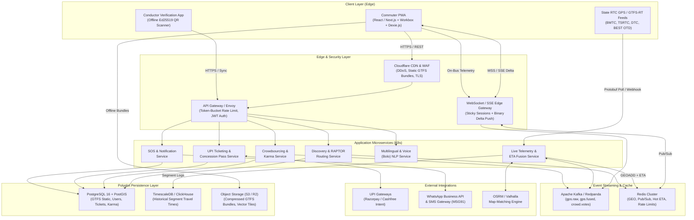
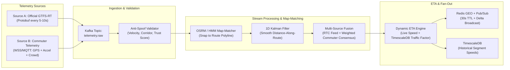
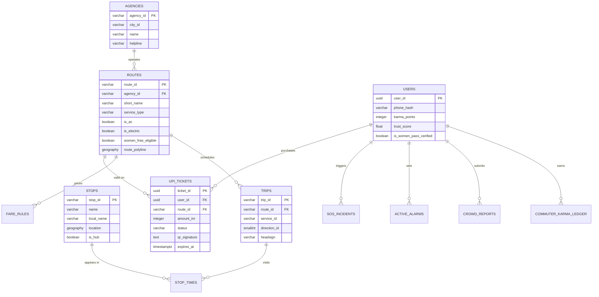
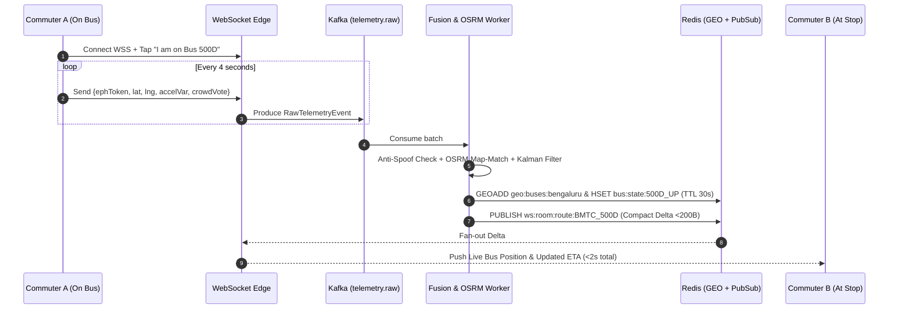
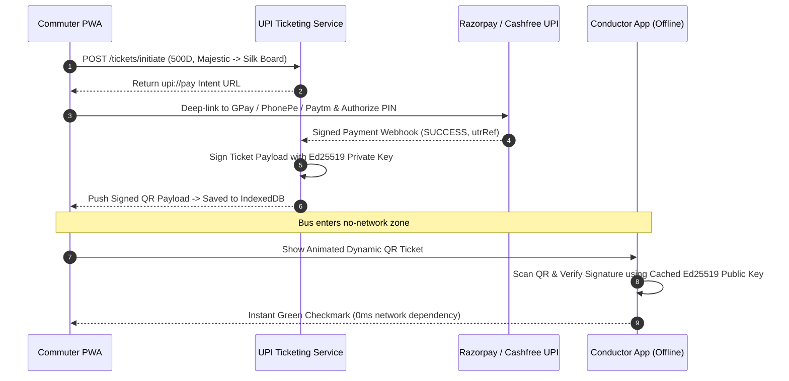
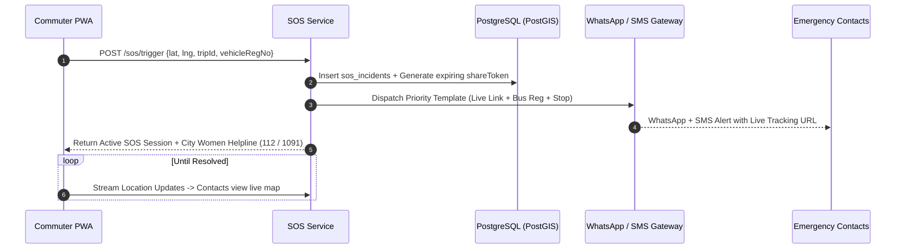

# Where is my BUS — System Architecture & Technical Specification (`ARCHITECTURE.md`)

**Version:** 1.0.0  
**Target Scale:** 1M+ Daily Active Commuters (DAC), 25,000+ Concurrent Vehicles, <2s End-to-End Telemetry Latency  
**Target Operators:** BMTC (Bengaluru), TSRTC (Hyderabad), DTC (Delhi), BEST (Mumbai), MTC (Chennai), MSRTC (Maharashtra), KSRTC (Kerala/Karnataka)  

---

## 1. High-Level System Architecture & C4 Diagrams

### 1.1 Architectural Pattern: Hybrid Event-Driven Microservices (Modular-First)
**"Where is my BUS"** is architected as a **Hybrid Event-Driven System** designed to handle an extreme read-to-write asymmetry:
* **Write-Heavy Telemetry Path (Ingestion):** Thousands of buses and tens of thousands of onboard commuters emit GPS pings every 3–10 seconds. This traffic is decoupled via an **API Gateway / MQTT-WebSocket Edge** into **Apache Kafka / Redis Streams**, allowing stateless stream workers to perform map-matching, Kalman filtering, and crowd-consensus fusion without blocking client connections.
* **Read-Heavy Commuter Path (Fan-Out):** Hundreds of thousands of waiting commuters subscribe to route timelines, stop radars, and ETA updates. Reads are served almost exclusively from **Redis In-Memory Geo/PubSub** and **CDN-cached static GTFS bundles**, keeping PostgreSQL/PostGIS insulated from real-time polling spikes.
* **Modular Monolith to Microservices Evolution:** For MVP/Beta (Phases 1–2), backend modules run inside a single Fastify/Node.js modular monolith (or Go services) sharing `@where-is-my-bus/shared-types`. As city count and telemetry throughput grow, the **Telemetry Ingestor**, **RAPTOR Routing Engine**, and **UPI Ticketing Service** split into independently autoscaled Kubernetes deployments along clear domain boundaries.

### 1.2 C4 System Context & Container Architecture



---

## 2. Real-Time GPS & Hybrid Crowdsourcing Ingestion Pipeline

Indian public transit suffers from intermittent hardware GPS (devices powered off, SIMs expired, or missing on rural/feeder routes). **"Where is my BUS"** solves this using a **Dual-Source Location Fusion Engine**.



### 2.1 Source A: Official Transit Feeds (GTFS-RT)
* **Mechanism:** Dedicated stateless Go/Node pollers fetch `VehiclePositions.pb` and `TripUpdates.pb` from State RTC / Smart City Open Transit Data (OTD) endpoints every **5–10 seconds** using `If-Modified-Since` / `ETag` headers.
* **Decoding:** Binary Protocol Buffers (`gtfs-realtime.proto`) are decoded into canonical `RawTelemetryEvent` JSON/Avro messages and published to Kafka topic `telemetry.raw` partitioned by `cityId:routeId`.
* **Reliability:** Circuit breakers isolate flaky municipal APIs; if an RTC feed stalls for >45 seconds, the fusion engine automatically promotes Source B (crowdsourced pings) to primary authority.

### 2.2 Source B: Crowdsourced "I Am On This Bus" Telemetry
* **Mechanism:** Commuters who tap **"I'm on this bus"** open a lightweight WebSocket (or MQTT-over-WS) stream sending telemetry every **4 seconds** (adaptive: 8s on battery saver):
  * `lat`, `lng`, `accuracyMeters`, `speedMps`, `bearing`
  * **Accelerometer variance** (distinguishes a moving bus from a stationary user at a tea stall or walking)
  * **Crowd occupancy vote:** `low` (🟢), `medium` (🟡), `high` (🔴)
* **Ephemeral Session:** Tied to a rotating `ephemeralSessionId` (never `userId`) to preserve commuter privacy.

### 2.3 Stream Processing, Map-Matching & Dynamic ETA
1. **Anti-Spoof & Outlier Filtering:**
   * Reject pings with `accuracyMeters > 80m`.
   * **Velocity Gate:** Reject jumps implying $>110\text{ km/h}$ inside city limits.
   * **Corridor Geofence:** Reject points $>150\text{ m}$ perpendicular distance from the route's PostGIS `LineString` geometry.
2. **Map-Matching (HMM / OSRM):**
   * Raw `(lat, lng)` is snapped onto the ordered route polyline using OSRM `match` / Hidden Markov Model emission probabilities, converting 2D coordinates into a 1D **route progress** scalar $s \in [0, L_{\text{route}}]$ (meters from origin).
3. **1D Kalman Filter & Multi-Ping Consensus:**
   * Multiple commuters on the same `tripId` are clustered by spatial proximity ($<60\text{ m}$).
   * Each ping is weighted by: $w_i = \text{trustScore}_i \times \frac{1}{\max(\text{accuracy}_i, 5)} \times \text{sourceWeight}$ (Official RTC hardware $= 1.0$, Verified High-Karma Commuter $= 0.85$, New User $= 0.45$).
   * A **1D Kalman Filter** over $(s, \dot{s})$ (position along route + speed) smooths GPS jitter and prevents backward-jumping bus icons.
4. **Dynamic Live ETA Calculation:**
   $$\text{ETA}_{\text{stop}} = \sum_{k=\text{curr}}^{\text{target}-1} \frac{d_k}{\alpha \cdot v_{\text{live}} + (1 - \alpha) \cdot v_{\text{hist}}(k, \text{hour}, \text{dayType}, \text{weather})}$$
   * Where $v_{\text{live}}$ is the Kalman-filtered vehicle speed, $v_{\text{hist}}$ is queried from TimescaleDB/Redis for that road segment at the current peak-hour bucket (e.g., Silk Board 6:00 PM vs. 2:00 PM), and $\alpha$ decays with distance ahead of the bus.

---

## 3. Database & Storage Architecture (Polyglot Persistence)

### 3.1 Entity-Relationship Diagram (Core Relational & Telemetry Model)



### 3.2 PostgreSQL 16 + PostGIS Schema (Core Relational & Geospatial Store)

```sql
CREATE EXTENSION IF NOT EXISTS postgis;
CREATE EXTENSION IF NOT EXISTS pgcrypto;

-- 1. GTFS STATIC TABLES
CREATE TABLE agencies (
    agency_id       VARCHAR(32) PRIMARY KEY,
    city_id         VARCHAR(32) NOT NULL,
    agency_name     VARCHAR(128) NOT NULL,
    agency_url      TEXT,
    timezone        VARCHAR(64) NOT NULL DEFAULT 'Asia/Kolkata',
    helpline_phone  VARCHAR(32),
    created_at      TIMESTAMPTZ NOT NULL DEFAULT NOW()
);

CREATE TABLE routes (
    route_id            VARCHAR(64) PRIMARY KEY,
    agency_id           VARCHAR(32) NOT NULL REFERENCES agencies(agency_id),
    route_short_name    VARCHAR(32) NOT NULL,
    route_long_name     VARCHAR(256) NOT NULL,
    route_type          SMALLINT NOT NULL DEFAULT 3, -- 3 = Bus
    service_type        VARCHAR(32) NOT NULL,        -- 'Ordinary', 'Vayu Vajra AC', 'Electric'
    is_ac               BOOLEAN NOT NULL DEFAULT FALSE,
    is_electric         BOOLEAN NOT NULL DEFAULT FALSE,
    women_free_eligible BOOLEAN NOT NULL DEFAULT FALSE,
    women_scheme_name   VARCHAR(64),                 -- 'Shakti', 'Mahalakshmi', 'Pink Ticket'
    route_polyline      GEOGRAPHY(LineString, 4326)
);
CREATE INDEX idx_routes_short_name ON routes (route_short_name);
CREATE INDEX idx_routes_polyline_gist ON routes USING GIST (route_polyline);

CREATE TABLE stops (
    stop_id         VARCHAR(64) PRIMARY KEY,
    city_id         VARCHAR(32) NOT NULL,
    stop_code       VARCHAR(32),
    stop_name       VARCHAR(160) NOT NULL,
    local_name      VARCHAR(160),                    -- Kannada/Hindi/Telugu/Tamil script
    landmark        VARCHAR(160),
    location        GEOGRAPHY(Point, 4326) NOT NULL,
    is_hub          BOOLEAN NOT NULL DEFAULT FALSE,
    wheelchair_ok   SMALLINT DEFAULT 0
);
CREATE INDEX idx_stops_location_gist ON stops USING GIST (location);
CREATE INDEX idx_stops_name_trgm ON stops (stop_name text_pattern_ops);

CREATE TABLE calendar (
    service_id      VARCHAR(64) PRIMARY KEY,
    monday          BOOLEAN NOT NULL,
    tuesday         BOOLEAN NOT NULL,
    wednesday       BOOLEAN NOT NULL,
    thursday        BOOLEAN NOT NULL,
    friday          BOOLEAN NOT NULL,
    saturday        BOOLEAN NOT NULL,
    sunday          BOOLEAN NOT NULL,
    start_date      DATE NOT NULL,
    end_date        DATE NOT NULL
);

CREATE TABLE trips (
    trip_id         VARCHAR(64) PRIMARY KEY,
    route_id        VARCHAR(64) NOT NULL REFERENCES routes(route_id),
    service_id      VARCHAR(64) NOT NULL REFERENCES calendar(service_id),
    direction_id    SMALLINT NOT NULL CHECK (direction_id IN (0, 1)),
    trip_headsign   VARCHAR(160)
);
CREATE INDEX idx_trips_route_dir ON trips (route_id, direction_id);

CREATE TABLE stop_times (
    trip_id             VARCHAR(64) NOT NULL REFERENCES trips(trip_id) ON DELETE CASCADE,
    stop_id             VARCHAR(64) NOT NULL REFERENCES stops(stop_id),
    stop_sequence       INTEGER NOT NULL,
    arrival_seconds     INTEGER NOT NULL, -- Seconds since midnight (supports >86400 for post-midnight)
    departure_seconds   INTEGER NOT NULL,
    shape_dist_traveled DOUBLE PRECISION,
    PRIMARY KEY (trip_id, stop_sequence)
);
CREATE INDEX idx_stop_times_stop_arr ON stop_times (stop_id, arrival_seconds);

CREATE TABLE fare_rules (
    fare_id         VARCHAR(64) PRIMARY KEY,
    route_id        VARCHAR(64) REFERENCES routes(route_id),
    origin_zone_id  VARCHAR(32),
    dest_zone_id    VARCHAR(32),
    min_km          NUMERIC(6,2) NOT NULL,
    max_km          NUMERIC(6,2) NOT NULL,
    fare_inr        NUMERIC(8,2) NOT NULL
);

-- 2. USER, CROWDSOURCING, SAFETY & TICKETING TABLES
CREATE TABLE users (
    user_id                 UUID PRIMARY KEY DEFAULT gen_random_uuid(),
    phone_hash              CHAR(64) UNIQUE NOT NULL, -- SHA-256 salted phone hash
    preferred_lang          VARCHAR(8) NOT NULL DEFAULT 'en',
    karma_points            INTEGER NOT NULL DEFAULT 0,
    trust_score             REAL NOT NULL DEFAULT 0.50 CHECK (trust_score BETWEEN 0.0 AND 1.0),
    is_women_pass_verified  BOOLEAN NOT NULL DEFAULT FALSE,
    created_at              TIMESTAMPTZ NOT NULL DEFAULT NOW()
);

CREATE TABLE commuter_karma_ledger (
    ledger_id       BIGSERIAL PRIMARY KEY,
    user_id         UUID NOT NULL REFERENCES users(user_id),
    delta_points    INTEGER NOT NULL,
    reason          VARCHAR(64) NOT NULL, -- 'LIVE_PING_VERIFIED', 'CROWD_VOTE', 'SPOOF_PENALTY'
    trip_id         VARCHAR(64),
    created_at      TIMESTAMPTZ NOT NULL DEFAULT NOW()
);
CREATE INDEX idx_karma_user_time ON commuter_karma_ledger (user_id, created_at DESC);

CREATE TABLE crowd_reports (
    report_id       BIGSERIAL PRIMARY KEY,
    trip_id         VARCHAR(64) NOT NULL,
    route_id        VARCHAR(64) NOT NULL,
    session_token   CHAR(64) NOT NULL, -- Ephemeral anonymized token
    crowd_level     SMALLINT NOT NULL CHECK (crowd_level IN (1, 2, 3)), -- 1=Low, 2=Med, 3=High
    reported_at     TIMESTAMPTZ NOT NULL DEFAULT NOW()
);
CREATE INDEX idx_crowd_trip_time ON crowd_reports (trip_id, reported_at DESC);

CREATE TABLE active_alarms (
    alarm_id        UUID PRIMARY KEY DEFAULT gen_random_uuid(),
    user_id         UUID NOT NULL REFERENCES users(user_id),
    route_id        VARCHAR(64) NOT NULL,
    target_stop_id  VARCHAR(64) NOT NULL REFERENCES stops(stop_id),
    radius_meters   INTEGER NOT NULL DEFAULT 500,
    is_active       BOOLEAN NOT NULL DEFAULT TRUE,
    created_at      TIMESTAMPTZ NOT NULL DEFAULT NOW()
);

CREATE TABLE sos_incidents (
    incident_id     UUID PRIMARY KEY DEFAULT gen_random_uuid(),
    user_id         UUID NOT NULL REFERENCES users(user_id),
    trip_id         VARCHAR(64),
    vehicle_reg_no  VARCHAR(32),
    last_location   GEOGRAPHY(Point, 4326) NOT NULL,
    share_token     VARCHAR(64) UNIQUE NOT NULL,
    status          VARCHAR(16) NOT NULL DEFAULT 'ACTIVE', -- 'ACTIVE', 'RESOLVED'
    created_at      TIMESTAMPTZ NOT NULL DEFAULT NOW(),
    resolved_at     TIMESTAMPTZ
);

CREATE TABLE upi_tickets (
    ticket_id       UUID PRIMARY KEY DEFAULT gen_random_uuid(),
    user_id         UUID NOT NULL REFERENCES users(user_id),
    route_id        VARCHAR(64) NOT NULL REFERENCES routes(route_id),
    origin_stop_id  VARCHAR(64) NOT NULL REFERENCES stops(stop_id),
    dest_stop_id    VARCHAR(64) NOT NULL REFERENCES stops(stop_id),
    passenger_count SMALLINT NOT NULL DEFAULT 1,
    fare_inr        NUMERIC(8,2) NOT NULL,
    is_women_free   BOOLEAN NOT NULL DEFAULT FALSE,
    upi_txn_ref     VARCHAR(128) UNIQUE,
    payment_status  VARCHAR(24) NOT NULL DEFAULT 'PENDING', -- 'PENDING', 'PAID', 'FAILED'
    qr_payload_jwt  TEXT,
    expires_at      TIMESTAMPTZ NOT NULL,
    verified_at     TIMESTAMPTZ,
    created_at      TIMESTAMPTZ NOT NULL DEFAULT NOW()
);
```

### 3.3 Redis In-Memory Geo & Pub/Sub Layer

| Key Pattern | Data Structure | TTL | Purpose |
| :--- | :--- | :--- | :--- |
| `geo:buses:{cityId}` | `GEO` (`GEOADD` / `GEOSEARCH`) | Member pruned every 30s | Live bus coordinates `(lng, lat, tripId)` for sub-5ms nearby stop radar |
| `bus:state:{tripId}` | `HASH` | `30s` | `{lat, lng, speedKmh, bearing, progressM, crowdLevel, delayMin, source, updatedAt}` |
| `route:eta:{routeId}:{stopId}` | `STRING` (JSON/MsgPack) | `15s` | Hot ETA cache for top upcoming buses at a stop |
| `ws:room:route:{routeId}` | `PUB/SUB` Channel | Ephemeral | Broadcasts `<200B` binary/JSON coordinate deltas to WebSocket edge nodes |
| `ratelimit:{ipOrUser}:{endpoint}` | `STRING` (Token Bucket) | `60s` | API & telemetry anti-spam throttling |

### 3.4 Time-Series Historical Store (TimescaleDB)

```sql
CREATE EXTENSION IF NOT EXISTS timescaledb;

CREATE TABLE segment_travel_telemetry (
    time_bucket     TIMESTAMPTZ NOT NULL,
    city_id         VARCHAR(32) NOT NULL,
    route_id        VARCHAR(64) NOT NULL,
    from_stop_id    VARCHAR(64) NOT NULL,
    to_stop_id      VARCHAR(64) NOT NULL,
    travel_sec      INTEGER NOT NULL,
    avg_speed_kmh   REAL NOT NULL,
    crowd_level     SMALLINT,
    weather_code    SMALLINT DEFAULT 0 -- 0=Clear, 1=Rain, 2=Heavy Monsoon
);

SELECT create_hypertable('segment_travel_telemetry', 'time_bucket', chunk_time_interval => INTERVAL '1 day');

-- Continuous Aggregate for Peak-Hour ETA Prediction Lookup
CREATE MATERIALIZED VIEW hourly_segment_speeds
WITH (timescaledb.continuous) AS
SELECT
    time_bucket('1 hour', time_bucket) AS hour_bucket,
    city_id,
    route_id,
    from_stop_id,
    to_stop_id,
    EXTRACT(DOW FROM time_bucket) AS day_of_week,
    AVG(avg_speed_kmh) AS expected_speed_kmh,
    PERCENTILE_CONT(0.85) WITHIN GROUP (ORDER BY travel_sec) AS p85_travel_sec
FROM segment_travel_telemetry
GROUP BY 1, 2, 3, 4, 5, 6;
```

---

## 4. Client-Side PWA & Low-Bandwidth Offline Architecture

Designed for **budget Android devices (2–3 GB RAM)** on **patchy 2G/3G/4G networks** during peak commute hours.

### 4.1 Frontend Stack
* **Framework:** React 18 / Next.js (App Router) + TypeScript
* **Styling:** Tailwind CSS (zero-runtime CSS, dark/high-contrast sunlight mode)
* **State & Data:** Zustand (ephemeral UI/map/telemetry state) + TanStack Query (stale-while-revalidate API caching)
* **Mapping:** Leaflet + OpenStreetMap / Protomaps PMTiles (lazy-loaded **only** when the user taps "Show Map")

### 4.2 Offline-First Storage Engine (`IndexedDB` + Workbox)
* **Workbox Service Worker:**
  * `CacheFirst` for app shell, icons, fonts, and Leaflet chunks.
  * `StaleWhileRevalidate` for `/api/v1/routes/popular` and `/api/v1/stops/search`.
* **Dexie.js (`IndexedDB`) Local Database:**
  * Stores compressed city GTFS mini-bundles (`stops`, `routes`, `stop_times` for saved/popular corridors — ~2–4 MB gzipped per city).
  * Stores **Active UPI QR Tickets** (`qr_payload_jwt`, `expires_at`, `route_short_name`) so commuters can display their ticket in basement terminals or dead zones with **zero network**.
  * Queues offline crowd votes and syncs them via **Background Sync API** when connectivity returns.

### 4.3 Delta Sync & "Where is my Train" Low-Data Mode
* **Compact Binary/Array WebSocket Payloads (<200 bytes):**
  Instead of verbose JSON objects, live updates push compact tuple arrays or MessagePack frames:
  ```json
  ["500D-T12", 12.9176, 77.6238, 28, 4, 2]
  // [tripId, lat, lng, speedKmh, etaDeltaMin, crowdLevel(1|2|3)]
  ```
* **Zero-Map Low-Data Mode:** A 1-tap toggle disables all Leaflet tile downloads and renders only the vertical **"Where is my Train"-style stop timeline**, cutting cellular data usage by **>90%** (~15 KB per 10-minute session).

### 4.4 Background Geolocation & "Wake Me Up" Destination Alarm
1. When the user activates a stop alarm, the PWA requests `Notification.requestPermission()` and registers a `navigator.geolocation.watchPosition` listener (with `enableHighAccuracy: true`, `maximumAge: 10000`).
2. On each GPS fix, the client computes **Haversine distance** $d$ to the target stop `(targetLat, targetLng)`:
   $$d = 2R \arcsin\left(\sqrt{\sin^2\left(\frac{\Delta\phi}{2}\right) + \cos\phi_1\cos\phi_2\sin^2\left(\frac{\Delta\lambda}{2}\right)}\right)$$
3. When $d \le 500\text{ m}$ (or 2 stops prior), the client triggers:
   * `ServiceWorkerRegistration.showNotification()` (works even if tab is backgrounded)
   * `navigator.vibrate([400, 200, 400, 200, 600])` + Web Audio API chime.

---

## 5. Microservices / Backend Module Breakdown & API Contracts

### 5.1 Discovery & Routing Service (RAPTOR / CSA Engine)
Computes direct routes and 1-hop transfer journeys across bus + metro stops using the **RAPTOR (Round-Based Public Transit Routing)** algorithm.

**Endpoint:** `GET /api/v1/routes/plan?cityId=bengaluru&fromStopId=STOP_MAJ&toStopId=STOP_SB&mode=smart_best`

```json
{
  "requestId": "req_99481a",
  "origin": { "stopId": "STOP_MAJ", "name": "Kempegowda Bus Station (Majestic)" },
  "destination": { "stopId": "STOP_SB", "name": "Central Silk Board" },
  "itineraries": [
    {
      "itineraryId": "itin_01",
      "badge": "FASTEST_DIRECT",
      "totalDurationMin": 46,
      "totalFareInr": 25,
      "womenFreeEligible": true,
      "legs": [
        {
          "type": "BUS",
          "routeId": "BMTC_500D",
          "routeNumber": "500D",
          "serviceType": "Non-AC",
          "boardStopId": "STOP_MAJ",
          "alightStopId": "STOP_SB",
          "stopCount": 18,
          "nextBusEtaMin": 4,
          "crowdLevel": "medium",
          "liveSource": "HYBRID_FUSED"
        }
      ]
    }
  ]
}
```

### 5.2 Live Telemetry & ETA Service
**WebSocket Endpoint:** `wss://api.whereismybus.in/v1/live/route/{routeId}?encoding=compact`  
**SSE Fallback:** `GET /api/v1/live/route/{routeId}/stream` (for restrictive corporate/2G proxies)

```json
{
  "type": "ROUTE_SNAPSHOT",
  "routeId": "BMTC_500D",
  "serverTs": 1795005120000,
  "vehicles": [
    {
      "tripId": "500D_UP_0830",
      "regNumber": "KA-01-F-9284",
      "lat": 12.9279,
      "lng": 77.6271,
      "bearing": 165,
      "speedKmh": 24,
      "progressM": 8420,
      "crowdLevel": "high",
      "crowdPercent": 82,
      "source": "CROWDSOURCED_CONSENSUS",
      "confidence": 0.91
    }
  ]
}
```

### 5.3 Crowdsourcing & Karma Service
**Endpoint:** `POST /api/v1/crowd/telemetry`

```json
{
  "sessionToken": "eph_7f8a91c2b3",
  "tripId": "500D_UP_0830",
  "routeId": "BMTC_500D",
  "lat": 12.9281,
  "lng": 77.6270,
  "accuracyMeters": 12.5,
  "speedMps": 6.8,
  "accelVariance": 0.42,
  "crowdVote": "high"
}
```

### 5.4 UPI Ticketing & Concession Pass Service
**Endpoint:** `POST /api/v1/tickets/initiate`

```json
{
  "routeId": "BMTC_500D",
  "originStopId": "STOP_MAJ",
  "destStopId": "STOP_SB",
  "passengerCount": 1,
  "claimWomenFreeScheme": false,
  "paymentMethod": "UPI_INTENT"
}
```
**Response (UPI Intent + Signed Offline QR upon Webhook Confirmation):**
```json
{
  "ticketId": "tkt_77a1b2c3",
  "fareInr": 25,
  "upiIntentUrl": "upi://pay?pa=whereismybus@icici&pn=WhereIsMyBus&tr=TKT77A1B2C3&am=25.00&cu=INR",
  "qrPayload": {
    "v": 1,
    "tid": "tkt_77a1b2c3",
    "r": "500D",
    "o": "STOP_MAJ",
    "d": "STOP_SB",
    "pax": 1,
    "exp": 1795012320,
    "sig": "ed25519_sig_base64..."
  }
}
```

### 5.5 Multilingual & Voice ("Bolo") NLP Service
**Endpoint:** `POST /api/v1/nlp/voice-intent`

```json
{
  "lang": "hi",
  "transcript": "Majestic se Silk Board ka AC bus kab aayega"
}
```
**Response:**
```json
{
  "intent": "FIND_ROUTE_ETA",
  "entities": {
    "originQuery": "Majestic",
    "resolvedOriginStopId": "STOP_MAJ",
    "destinationQuery": "Silk Board",
    "resolvedDestStopId": "STOP_SB",
    "filters": ["AC"]
  },
  "ttsReply": "Majestic se Silk Board ke liye agla AC bus 500D 6 minute mein aa raha hai."
}
```

---

## 6. Sequence Diagrams for Critical User Flows

### 6.1 Live Bus Radar & Crowdsourced GPS Fusion Flow



### 6.2 1-Click UPI QR Ticket Purchase & Conductor Offline Verification Flow



### 6.3 SOS Emergency Live Ride Share Flow



---

## 7. Security, Privacy & Anti-Spoofing Architecture

| Threat Vector | Mitigation Strategy |
| :--- | :--- |
| **Fake GPS / Mock Location Apps** | 1. **Velocity & Acceleration Gate:** Compare GPS speed against accelerometer variance; stationary phones claiming $40\text{ km/h}$ are rejected.<br>2. **Route Corridor Geofence:** Coordinates $>150\text{ m}$ outside the PostGIS route `LineString` are dropped.<br>3. **Multi-User Consensus:** A single low-trust user cannot override an active RTC feed or 2+ high-karma commuters; anomalies trigger trust-score decay. |
| **Commuter Tracking / Privacy Leak** | "I am on this bus" streams use **ephemeral rotating session tokens** (`eph_*`) decoupled from `user_id` and `phone_hash` at the WebSocket gateway. Historical telemetry stores only aggregated vehicle/segment speeds—never individual user paths. |
| **QR Ticket Screenshot Fraud** | 1. **Ed25519 Asymmetric Signatures:** Conductor app verifies ticket authenticity offline using the embedded public key.<br>2. **Visual Anti-Screenshot Watermark:** Live ticking seconds clock + rotating color-shift border + trip/time-bound `exp` claim. |
| **API Abuse & DDoS** | Cloudflare WAF at edge + Redis **Token Bucket** rate limiting per IP/user (`60 req/min` for search, `20 req/min` for telemetry writes), OTP + short-lived JWT (`15m`) with refresh rotation. |

---

## 8. Infrastructure, DevOps, Scalability & Cost Optimization (India Scale)

### 8.1 Cloud & Deployment Topology (Mumbai `ap-south-1` / Hyderabad `ap-south-2`)
* **MVP / Beta (<50K DAC):** Single-region Docker Compose / Fly.io or AWS ECS Fargate + Managed Postgres (Neon/RDS) + Upstash/Managed Redis (~$80–$150/month).
* **Production Scale (1M+ DAC):**
  * **Compute:** AWS EKS (Kubernetes) in `ap-south-1` (Mumbai) with Karpenter autoscaling on Spot Instances for stateless stream workers.
  * **Edge:** Cloudflare Workers + R2 Object Storage for zero-egress static GTFS offline bundles and Protomaps vector tiles.
  * **Streaming:** Redpanda (Kafka-compatible C++ engine) for lower memory overhead and sub-5ms p99 tail latency compared to JVM Kafka.

### 8.2 CI/CD Pipeline (GitHub Actions)
1. **PR Check:** `pnpm turbo run typecheck lint test` + PostGIS migration dry-run.
2. **Build & Scan:** Multi-stage Docker builds pushed to AWS ECR + Trivy container vulnerability scan.
3. **Zero-Downtime Deploy:** ArgoCD / Helm rolling updates with readiness probes (`/healthz`) and automated rollback on 5xx spike.

### 8.3 Observability Stack
* **Metrics:** Prometheus + Grafana dashboards tracking:
  * `kafka_consumergroup_lag` (alert if $>5\text{ s}$)
  * `ws_active_connections` & `ws_broadcast_latency_ms` (target p95 $<200\text{ ms}$)
  * `gtfs_rt_feed_staleness_seconds` per State RTC
* **Tracing & Errors:** OpenTelemetry distributed traces + Sentry for PWA offline/JS crash telemetry.

---

## 9. Complete Monorepo Folder Structure

```text
where-is-my-bus/
├── .github/
│   └── workflows/
│       ├── ci-test.yml
│       └── cd-deploy-eks.yml
├── apps/
│   ├── web-pwa/                        # Next.js / React Commuter PWA
│   │   ├── public/
│   │   │   ├── manifest.json
│   │   │   └── sw.js                   # Workbox Service Worker
│   │   └── src/
│   │       ├── app/                    # Routes & Tabs (Home, Search, Saved, Tickets)
│   │       ├── components/             # Timeline, Lazy Leaflet Map, Modals (UPI, SOS, Alarm)
│   │       ├── db/                     # Dexie.js IndexedDB offline schema & sync queue
│   │       ├── hooks/                  # useDeltaSocket, useGeoAlarm, useOfflineGtfs
│   │       └── store/                  # Zustand stores
│   └── api-server/                     # Modular Backend (Fastify / TypeScript)
│       └── src/
│           ├── gateway/                # HTTP & WebSocket/SSE Edge handlers
│           ├── modules/
│           │   ├── discovery/          # RAPTOR & Stop Search API
│           │   ├── telemetry/          # GTFS-RT poller + Kafka consumer + Kalman worker
│           │   ├── crowd/              # Crowdsourcing + Anti-spoof + Karma ledger
│           │   ├── ticketing/          # UPI Intent + Ed25519 QR signer + Webhooks
│           │   ├── nlp/                # Multilingual "Bolo" voice intent parser
│           │   └── sos/                # Live ride share + WhatsApp/SMS dispatcher
│           └── server.ts
├── packages/
│   ├── gtfs-engine/                    # Shared Transit Algorithms
│   │   └── src/
│   │       ├── protobuf/               # GTFS-RT .proto & decoders
│   │       ├── raptor/                 # Multi-modal RAPTOR pathfinder
│   │       ├── kalman/                 # 1D route-progress Kalman filter
│   │       └── bundler/                # Static GTFS -> compressed PWA JSON/MsgPack bundler
│   ├── database/                       # Drizzle / Prisma + PostGIS Migrations
│   │   ├── migrations/
│   │   ├── schema/
│   │   └── seed/                       # City presets (BMTC, TSRTC, DTC, BEST)
│   └── shared-types/                   # Canonical TS Interfaces & Zod Schemas
│       └── src/
│           ├── transit.ts
│           ├── telemetry.ts
│           └── ticketing.ts
├── infra/
│   ├── docker/
│   ├── k8s/                            # Helm charts & HPA manifests
│   └── terraform/                      # VPC, EKS, RDS PostGIS, Redis, R2
├── package.json
├── pnpm-workspace.yaml
└── turbo.json
```

---

## 10. Phased Implementation Roadmap (MVP to Production)

### Phase 1: Weekend Prototype (Validation & Core UX)
* **Scope:** Single-file/static GTFS dataset for 1 corridor, simulated GPS movement, lazy-loaded Leaflet map, and "Where is my Train"-style vertical bus timeline.
* **Milestone:** Sub-second route search, responsive mobile-first PWA shell, and basic local `localStorage` saved routes.

### Phase 2: Beta Launch for 1 City (e.g., Bengaluru BMTC)
* **Scope:** PostgreSQL + PostGIS setup, GTFS static ingestion, real GTFS-RT Protobuf poller, Redis `GEO` + `Pub/Sub` layer, and Workbox + Dexie.js offline timetable caching.
* **Milestone:** Live real-time bus tracking for 1 city with `<2s` WebSocket updates and Zero-Map Low-Data mode.

### Phase 3: Community Scale & Accessibility
* **Scope:** Crowdsourced "I am on this bus" WebSocket ingestion, Kafka + Kalman + OSRM map-matching fusion, Karma & anti-spoofing rules, Haversine destination wake-up alarms, and Multilingual Voice ("Bolo") search (`en`, `hi`, `kn`, `te`, `ta`).
* **Milestone:** Accurate live tracking even on routes with broken/missing RTC GPS hardware.

### Phase 4: Monetization, Safety & Multi-City Expansion
* **Scope:** 1-Click UPI Intent QR ticketing (Razorpay/Cashfree), Ed25519 offline Conductor Verification App, Women's Free Scheme pass integration (Shakti/Mahalakshmi), SOS WhatsApp live ride sharing, and TimescaleDB historical ETA ML model across 8+ Indian cities.
* **Milestone:** Production-hardened, multi-city transit platform capable of 1M+ Daily Active Commuters.
